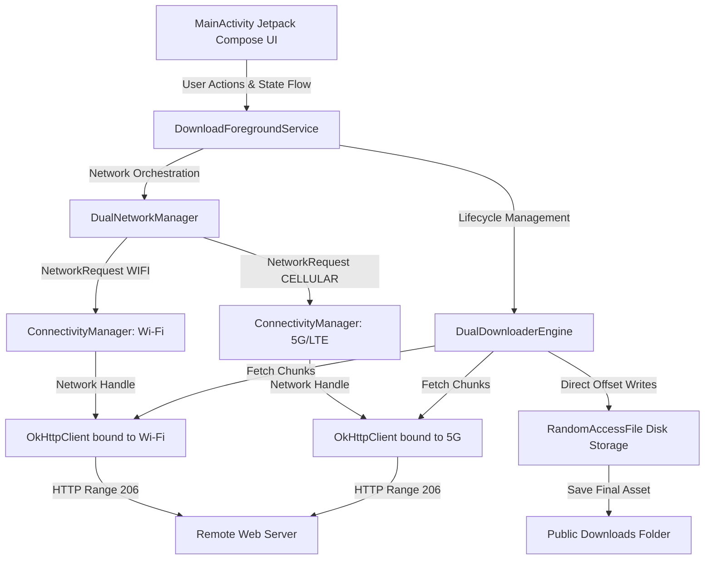
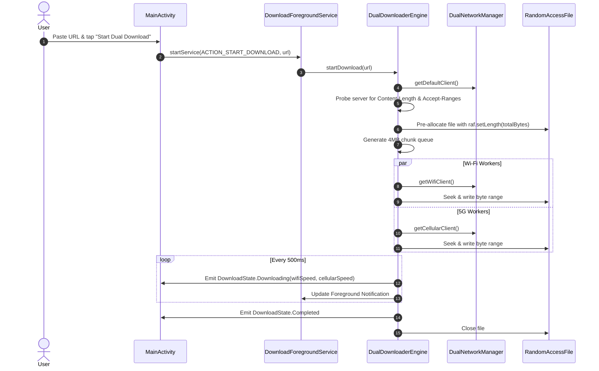

# Architecture

## System Overview
DualBoost Downloader is an Android application that enables simultaneous multi-network data transfer on devices equipped with multiple network interfaces (Wi-Fi and Cellular). Rather than relying on the operating system's default single-interface routing table, the application binds independent network sockets to distinct physical interfaces using Android's `ConnectivityManager` and `Network.socketFactory`.

## System Diagram



## Tech Stack
- **Language**: Kotlin 2.0.21
- **Platform**: Android SDK 35 (Target: Android 15 / Pixel 9, Min: API 26)
- **UI Framework**: Android Jetpack Compose with Material 3
- **Concurrency**: Kotlin Coroutines (`kotlinx.coroutines.android` 1.9.0) with StateFlow
- **Networking**: Square OkHttp 4.12.0 (TLS 1.2+ `MODERN_TLS` & Certificate Pinning)
- **Security & Crypto**: AndroidX Security Crypto (`security-crypto` 1.1.0-alpha06) for Keystore-backed AES-256-GCM
- **Build System**: Gradle 8.10.2 via Kotlin DSL (`build.gradle.kts`)
- **Tooling**: Android Debug Bridge (ADB), Command-Line Tools (no IDE dependency)

## Repository Structure
```
app/src/main/
├── AndroidManifest.xml
└── java/com/dualboost/downloader/
    ├── data/
    │   └── DownloadModel.kt               # StateFlow models and chunk descriptors
    ├── network/
    │   └── DualNetworkManager.kt          # Dual-interface socket binding
    ├── engine/
    │   └── DualDownloaderEngine.kt        # Adaptive work queue & RandomAccessFile writer
    ├── service/
    │   └── DownloadForegroundService.kt   # Android dataSync Foreground Service
    └── ui/
        ├── MainActivity.kt                # Compose screen & Share Sheet receiver
        └── theme/Theme.kt                 # Material 3 color schemes
```

## Application Layers
1. **Presentation Layer (`com.dualboost.downloader.ui`)**:
   - `MainActivity`: Lifecycle observer, clipboard monitor, Intent handler (`ACTION_SEND`), and Compose layout renderer featuring Smart Context Pill Banner, `SegmentedChunkStrip`, and celebratory completion banner.
   - `MainViewModel`: Application-scoped ViewModel orchestrating URL inputs, clipboard auto-detection (`detectedClipboardUrl`), preset selection models (`QuickTestPreset`), and action enablement state machine.
   - Collects `StateFlow` from `DownloadRepository` to display live speed gauges, countdown ETA remaining, dual-color interface ratios, multi-block chunk visualizers (`ChunkSnapshot`), and error recovery states.
   - **Stream Visualizer Palette & Material You Theming (`ADR-043`)**: Visualizer colors for Wi-Fi and Cellular are dynamically resolved from `StreamPalette` (`DYNAMIC_MATERIAL_YOU`, `CYBERPUNK_NEON`, `EMERALD_AMBER`, `SUNSET_CORAL`), extracting wallpaper dynamic accents (`MaterialTheme.colorScheme.primary` and `tertiary`) on Android 12+ or using curated high-contrast dual-tone pairs.
2. **Repository & Application Layer (`com.dualboost.downloader.data`, `DualBoostApp`)**:
   - `DualBoostApp`: `Application` class holding the singleton `DownloadRepository`.
   - `DownloadRepository`: Coordinates `DualNetworkManager` and `DualDownloaderEngine`, dispatching background tasks to `DownloadForegroundService` without relying on ephemeral service bindings.
3. **Service Layer (`com.dualboost.downloader.service`)**:
   - `DownloadForegroundService`: Keeps process alive when screen locks or app moves to background.
   - Holds Android `PowerManager.PARTIAL_WAKE_LOCK` with automated 25-minute periodic renewal job to prevent CPU throttling on multi-hour downloads.
   - Manages Android `NotificationManager` with a 1000ms throttler to avoid system message shedding and sets `NotificationCompat.VISIBILITY_PRIVATE` for lock-screen privacy.
   - Implements Android 15 (API 35) `onTimeout(startId, fgsType)` to gracefully pause downloads and release resources when reaching the system 6-hour `dataSync` execution limit.
   - Decoupled from application-wide network monitoring: does not invoke `networkManager.stopListening()` in `onDestroy()`, preserving active telemetry for `DualBoostApp`. Invokes `stopSelf()` after `stopForeground(STOP_FOREGROUND_DETACH)` to eliminate orphaned processes.
   - Guards against race conditions by checking current engine state before initiating downloads.
4. **Execution Engine Layer (`com.dualboost.downloader.engine`)**:
   - `DualDownloaderEngine`: Dynamically computes headers, probes remote servers, validates storage via `StatFs`, partitions files into 4MB byte segments, manages concurrent work queues, produces live `ChunkSnapshot` arrays, calculates ETA countdown seconds (`formatEta`), computes binary Megabytes per second (`MB/s`) speed with adaptive `KB/s` formatting (`formatSpeed`), handles single-stream non-range server fallbacks, and writes to disk via a single shared `RandomAccessFile` handle serialized under `fileWriteMutex`.
   - **Download Integrity & Boundary Capping**: Strictly rejects HTTP 200 responses for chunks with `startByte > 0`, caps chunk writes to `min(buffer.size, expectedChunkBytes - bytesReceived)`, and verifies `outputFile.length() == contentLength` post-transfer. Single-stream fallbacks enforce `totalLength <= 0 || totalRead == totalLength` and `outputFile.length() == totalLength` before marking `Completed`.
   - **Fail-Closed Resumption**: Pre-flight verifies physical file existence and byte length prior to `setLength()` allocation. Missing or altered physical files trigger metadata discard and clean restart from byte 0. Revalidates remote ETag and Last-Modified headers fail-closed.
   - **Active Auto-Recovery & Circuit Breaking**: Emits `DownloadState.AutoRecovering` with exponential backoff (1s -> 2s -> 4s) when both network interfaces trip circuit breakers, capping chunk retries at 5 attempts before transitioning to `DownloadState.Paused`.
   - `SpeedTestEngine`: Ephemeral 3-phase throughput benchmark engine (Wi-Fi 3s -> 5G 3s -> DualBoost 4s) streaming bytes directly into an in-memory discard buffer (0 bytes stored on disk) and reporting real-time speeds in `MB/s`.
5. **Transport Layer (`com.dualboost.downloader.network`)**:
   - `NetworkProvider`: Decoupled interface defining interface availability, signal level telemetry, cellular generation state, and client factories, allowing seamless MockWebServer integration testing.
   - `DualNetworkManager`: Listens to `ConnectivityManager` callbacks for `TRANSPORT_WIFI` and `TRANSPORT_CELLULAR`.
   - Produces dedicated `OkHttpClient` instances whose sockets are locked to specific physical interfaces, enforcing `MODERN_TLS` (TLS 1.2+ with forward secrecy) and `CertificatePinner` for `*.workers.dev` endpoints. Cellular workers strictly route through `cellularClient`, never falling back to unbound default clients.
   - **Signal Telemetry & Generation Detection**:
     - Wi-Fi signal level is continuously computed via `NetworkCapabilities.signalStrength` (API 29+) or legacy `WifiManager.calculateSignalLevel(rssi, 5)`.
     - Wi-Fi generation, frequency band, and negotiated link speed (`WifiGeneration`, `WifiDetails`) are extracted via `capabilities.transportInfo as? WifiInfo` on Android 29+ (ADR-041), resolving Wi-Fi 7 (802.11be), Wi-Fi 6E (6 GHz), Wi-Fi 6 (5 GHz), and Wi-Fi 5 (ac) with link speeds, progressive frequency fallbacks, and adaptive label tiers (`shortLabel`, `detailLabel`, `richHeroLabel`).
     - Cellular signal level is computed via `NetworkCapabilities.signalStrength` mapped across 5 discrete buckets (0..4).
     - Cellular generation (`CellularGeneration.FIVE_G`, `FOUR_G`, `THREE_G_OR_LOWER`, `UNKNOWN`) is resolved via `CellularGeneration.fromTelephony(networkType, overrideNetworkType, downstreamBandwidthKbps)` backed by `TelephonyCallback.DisplayInfoListener` and continuous `NetworkCapabilities` re-evaluation (`ADR-040`, `ADR-048`):
       - **5G NSA Anchor Resolution**: In 5G NSA, `telephonyManager.dataNetworkType` returns LTE 13; `latestOverrideNetworkType` (`OVERRIDE_NETWORK_TYPE_NR_NSA` / `NR_ADVANCED`) from `DisplayInfoListener` (requiring `READ_PHONE_STATE`) cleanly unlocks 5G identification.
       - **Downstream Bandwidth Heuristic**: If downstream link bandwidth $\ge 120_000\text{ Kbps}$ (120 Mbps), classifies as 5G as a robust zero-permission hardware-level indicator of active 5G NR carrier aggregation.
       - **Dynamic Modem Radio Wake-Up**: Modern Android modems power down the 5G NR RF front-end into LTE sleep during idle. Calling `refreshCellularGeneration()` the moment download data begins catches the carrier's Secondary Cell Group (SCG) activation and immediately transitions UI hero labels and telemetry to 5G in real-time.
       - **User Agency Modes (`CellularNetworkMode`)**: Users can toggle between `Auto-Detect (Dynamic)`, `Force 5G Mode`, and `Force 4G Mode` via Settings, with preferences persisted in `CellularPreferences` and live badges rendered on active cards.
       - Each enum provides adaptive two-tier label properties (`shortLabel`, `detailLabel`, `fullDisplayName`) consumed dynamically across the UI, modals, speed tests, and foreground service notifications.
      - **On-Demand Cellular Radio Lifecycle**: During idle state, `DualNetworkManager` maintains a passive `registerNetworkCallback` to observe cellular signal strength and carrier metadata with 0 idle radio battery drain. When active downloads or benchmarks trigger (`startDownload`, `onStartCommand`, `startSpeedTest`), `acquireCellularKeepAlive()` issues an explicit `requestNetwork` to lock the mobile data radio on; upon completion, pause, cancellation, or failure, `releaseCellularKeepAlive()` unregisters the request to allow the modem to enter deep sleep.
      - **Adaptive Thermal Backoff (`ThermalStatusProvider`)**: Dynamically monitors Android 10+ system thermals (`PowerManager.addThermalStatusListener`). Under `THERMAL_STATUS_MODERATE` (2), active cellular concurrency strictly throttles down to at most 1 worker. Under `THERMAL_STATUS_SEVERE` (3+), cellular transfers pause completely and offload 100% of chunk traffic to Wi-Fi to cool down RF front-ends; if Wi-Fi is unavailable, cellular safely throttles to a single paced worker.
      - **Dynamic Multi-Thread Concurrency Tuning & Auto-Scaling (`ADR-042`)**: Concurrency is dynamically tuned via `ConcurrencyConfig` and persisted via `ConcurrencyPreferences`:
        - Configurable per-interface worker streams (`1..8` for Wi-Fi, `1..8` for Cellular, default `2 + 2`).
        - **Auto-Scale Mode**: Dynamically expands worker coroutines by up to +2 slots (ceiling 8) when aggregate link throughput exceeds `25.0 MB/s` under cool thermals (`ThermalStatus.NONE` or `LIGHT`), saturating multi-gigabit connections.
        - **Fail-Safe Thermal Guard**: Thermal throttling overrides user-configured stream counts without exception (`MODERATE` caps cellular to 1 stream, `SEVERE` drops cellular to 0).
      - **64 KB Stream Buffer Coalescing**: Chunk streaming workers coalesce byte-range responses into 64 KB buffers (`65,536` bytes), reducing file seek syscalls and `fileWriteMutex` locks by 50% compared to 32 KB and 87.5% compared to 8 KB buffers, slashing CPU wake locks and write amplification on multi-gigabyte transfers.
      - **Asymmetric Work-Stealing & Dynamic Chunk Batching (`ADR-035`)**: To eliminate bottlenecks when physical links exhibit extreme bandwidth asymmetry (e.g. 500 Mbps 5G vs 20 Mbps Wi-Fi), the engine dynamically scales chunk batch sizes:
        - `< 15 MB/s`: 1 chunk (4 MB standard request)
        - `15 .. 30 MB/s`: 2 chunks (8 MB batched span in a single HTTP Range request)
        - `> 30 MB/s`: 4 chunks (16 MB batched span in a single HTTP Range request)
      - **Speculative Straggler Tail Hedging**: When the pending queue empties and fast workers become idle, the engine detects any in-flight chunk assigned to a slower interface that has > 512 KB remaining, speculatively requesting the unread tail range (`Range: bytes=tailStart-tailEnd`). Whichever worker completes writes to disk safely with `fileWriteMutex`, completely eliminating tail-end download stalls.
     - Immediate Completion & Zero-Post-Processing: Full-file synchronous SHA-256 calculation on completion is bypassed for standard downloads, guaranteeing instant 100% completion without flash read bottlenecks or thermal throttling on multi-gigabyte files (e.g. 30 GB).
    - **Multi-OEM & Network Compatibility Hardening**:
      - **Roaming Guard (`NET_CAPABILITY_NOT_ROAMING`)**: Cellular network requests strictly filter out roaming interfaces, and `isRoamingActive` detects when the device is operating on a roaming carrier network. When roaming is active, `getCellularClient()` immediately returns `null` and the UI alerts the user, preventing unexpected mobile data bill shock.
      - **Automatic VPN-Safe Fallback (`TRANSPORT_VPN`)**: Listens to system default network callbacks to detect active VPN connections. When a VPN is active (`isVpnActive = true`), raw physical socket binding (`Network.socketFactory`) is bypassed because it causes OS security exceptions (`EPERM`) or leaks traffic outside the encrypted tunnel. Instead, both Wi-Fi and Cellular workers safely route multi-stream transfers through `baseOkHttpClient` into the system's encrypted `tun0` interface.
      - **Multi-SIM Carrier Transparency & Modem Standby Diagnostics**: `cellularCarrierName` identifies the active mobile network operator via `TelephonyManager.simOperatorName`/`networkOperatorName`. When Wi-Fi is connected but cellular requests remain unfulfilled due to vendor modem sleep configurations, `isModemStandbyDetected` is flagged to guide the user to enable "Mobile data always active" in Android Developer Options.
      - **Proactive Battery Exemption Guidance**: `PowerExemptionChecker` evaluates system battery optimizations (`PowerManager.isIgnoringBatteryOptimizations`) against known aggressive OEM task killers (Samsung, Xiaomi, Huawei, OnePlus, Oppo, Vivo, Meizu, Asus). When non-exempt on these OEMs, `showBatteryGuidance` prompts users with one-tap navigation to system battery exemption settings.

## Database Architecture & Persistence
- **Runtime Engine State**: In-memory state management. Chunks and real-time telemetry reside in memory with atomic `.dualboost_meta` sidecar files in `context.noBackupFilesDir/dualboost_meta` for pause/resume continuity. Shared storage fallback is completely eliminated.
- **Download History & File Library**: App-private atomic JSON ledger (`DownloadHistoryRepository`) storing completed download records in `context.noBackupFilesDir/download_history.json`. Uses pure Kotlin JSON serialization with atomic `.tmp` staging, thread-safe Mutex locking, and reactive `StateFlow` exposure with zero SQLite/Room overhead. Enables persistent storage metering, existence tracking, and safe `FileProvider` triggers (`ACTION_VIEW`, `ACTION_SEND`). When files are exported to public storage and app-directory files are purged, `isFilePresent()`, `openFile()`, and `shareFile()` verify existence and launch intents using `contentUriString`. Canonical boundary validation (`canonicalPath.startsWith(safeRoot.canonicalPath + File.separator)`) is enforced on physical file deletion.

## API Architecture
The app communicates with third-party HTTP/HTTPS servers implementing standard RFC 7233 Range Requests:
1. **Probe Phase**:
   ```http
   HEAD /large-archive.zip HTTP/1.1
   Host: example.com
   ```
   Or fallback range test:
   ```http
   GET /large-archive.zip HTTP/1.1
   Host: example.com
   Range: bytes=0-0
   ```
2. **Segmented Chunk Phase**:
   ```http
   GET /large-archive.zip HTTP/1.1
   Host: example.com
   Range: bytes=0-4194303
   ```

## External Services
- No proprietary cloud servers, proxy servers, or third-party tracking services are used.
- All connections connect directly point-to-point from device to the target download host.

## Data Flow



## Architectural Patterns
- **Channel Bonding at Application Layer**: Segmenting workloads across disparate interfaces at the HTTP layer instead of kernel/packet bonding.
- **Dynamic Work Queue**: Workers pull chunks on demand. Faster connections naturally claim more chunks, preventing straggler bottlenecks.
- **Zero-Copy Disk Writes**: Direct offset seek and write eliminates the memory and CPU overhead of joining temp files at the end.

## System Boundaries
- **App Boundary**: Bounded by standard Android application permissions (`INTERNET`, `ACCESS_NETWORK_STATE`, `POST_NOTIFICATIONS`, `FOREGROUND_SERVICE`, `FOREGROUND_SERVICE_DATA_SYNC`). Cleartext traffic is blocked system-wide via `network_security_config.xml`.
- **OS Boundary**: Relies on Android's `ConnectivityManager.requestNetwork` to override the default single-network routing rule.

## Scalability Considerations
- Chunk size is tuned to 4 MB to optimize HTTP handshake overhead against load distribution efficiency.
- Concurrency is capped at 4 simultaneous coroutines (2 Wi-Fi, 2 5G) to avoid socket thrashing or TCP congestion collapses on mobile networks.

## Security Architecture
- **Transport Security**: TLS 1.3 / HTTPS strictly enforced via `android:usesCleartextTraffic="false"` and `network_security_config.xml`. Cleartext HTTP is blocked across all network requests.
- **Fail-Closed Header-Only Worker Authentication (`SEC-002`, `SEC-011`)**: Cloud Slicer strictly checks the `X-Slicer-Key` HTTP header using constant-time string comparison (`timingSafeEqual`) to prevent timing side-channel attacks and open proxy abuse. Secret keys are never transmitted via URL query parameters (`?key=`), nor leaked during `/health` connectivity tests.
- **Fortified Anti-SSRF & DNS Rebinding Protection (`SEC-001`, `SEC-012`, `ADR-031`)**: Cloud Slicer validates target URLs (`validateTargetUrl`), rejecting non-HTTP/HTTPS protocols, RFC 1918 private subnets, loopback (`127.0.0.1`, `localhost`), link-local/cloud metadata (`169.254.169.254`), CGNAT, wildcard dynamic DNS rebinding services (`*.nip.io`, `*.sslip.io`, etc.), internal TLDs (`.local`, `.internal`, `.lan`), IPv4-mapped IPv6 literals (`[::ffff:x.x.x.x]`), NAT64 (`64:ff9b::/96`), 6to4 (`2002::/16`), and unique local addresses (`fc00::/7`). Worker fetches enforce `redirect: 'manual'` (rejecting 3xx with HTTP 403) and fail-closed DoH resolution.
- **Upstream Range Enforcement & Bandwidth Protection (`ADR-031`)**: Worker rejects non-range upstream responses with HTTP 501 Not Implemented, eliminating $O(n^2)$ read-and-discard bandwidth amplification.
- **Edge Stream Bounds (`SEC-005`)**: Maximum slice sizes are clamped to 16 MB (`MAX_SLICE_SIZE = 16 * 1024 * 1024`) to eliminate edge memory exhaustion.
- **Path Traversal Containment (`SEC-003`, `ADR-031`)**: Android filename extraction from `Content-Disposition` and URL paths strips all directory traversal sequences (`/`, `\`) and sanitizes special characters (`[a-zA-Z0-9._\-\s()]`). All delete paths (`discardDownload`, `deletePhysicalFile`) strictly validate canonical containment against download roots (`canonicalPath.startsWith(safeRoot.canonicalPath + File.separator)`).
- **Silent Download Corruption Defense (`ADR-031`)**: Ranged chunk workers immediately reject HTTP 200 on non-zero offsets, strictly cap buffer writes to `min(buffer.size, remaining)`, and verify `file.length() == contentLength`. Single-stream transfers assert `totalRead == totalLength` and `file.length() == totalLength`. Resumption pre-flight verifies physical file presence and length before allocating storage, discarding sidecars on discrepancies.
- **Sidecar Metadata Isolation (`SEC-009`, `ADR-031`)**: `.dualboost_meta` session files are stored strictly within the application's private internal storage (`context.noBackupFilesDir/dualboost_meta`), completely shielding download URLs, ETags, and tokens from third-party app inspection. Shared storage fallback is completely removed.
- **Intent Injection Defense (`SEC-004`)**: Exported `MainActivity` strictly pre-populates shared URLs without unauthenticated background download execution (`auto_start` removed).
- **Backup & Credential Isolation (`SEC-006`, `ADR-055`)**: `android:allowBackup="false"` prevents extraction of SharedPreferences or user secrets via ADB or physical backups. All sensitive preferences—including Cloud Slicer secret tokens (`SlicerPreferences`) and Google Safe Browsing API keys (`SecurityPreferences`)—are encrypted via Android Keystore-backed AES-256-GCM (`EncryptedSharedPreferences`) with automatic migration from legacy plaintext stores.
- **Zero-Permission Privacy Architecture (`ADR-055`)**: The app avoids broad telephony permissions (`READ_PHONE_STATE`), relying solely on `READ_BASIC_PHONE_STATE` for 5G NR NSA / 5G Advanced identification without exposing device identifiers or call status.
- **Obfuscated Payload Header Protection (`ADR-055`)**: `ThreatDetectionEngine` parses RFC 5987 / RFC 6266 percent-encoded filenames (`filename*=UTF-8''...`) via `URLDecoder.decode()`, preventing attackers from bypassing executable/APK extension detection via URL-encoding.
- **Safe JSON Construction (`ADR-055`)**: `CloudThreatScanner` sanitizes all target URLs before embedding in Google Safe Browsing JSON request templates, preventing payload malformation.
- **Logcat Privacy Sanitization (`SEC-007`, `ADR-031`)**: All logged URLs and exception messages are stripped of query parameters (`?`) via `sanitizeLogMessage` to protect pre-signed authorization tokens from exposure.
- **Cryptographic File Integrity (`SEC-013`)**: Streaming SHA-256 integrity calculation upon download completion with interactive 1-click clipboard verification badge in the Compose UI.
- **Dedicated Release Signing Pipeline (`ADR-031`)**: Release builds sign exclusively with dedicated release certificates generated locally or provided via credentials, completely eliminating debug keystore usage in release artifacts.

## Deployment Architecture
- Built via Gradle CLI (`.\gradlew.bat assembleRelease`).
- Authentic release APK generated at `app/build/outputs/apk/release/app-release.apk`.
- Deployed directly to attached Android device via ADB (`adb install -r app-release.apk`).
- Tested headlessly via `adb shell am start` and monitored via `adb logcat`.

## Architecture Decisions
- *Decision*: Native Kotlin over Flutter/React Native. *Rationale*: Deep integration with Android `ConnectivityManager` and `Network.socketFactory` requires low-level platform APIs.
- *Decision*: Direct `RandomAccessFile` over temp file concatenation. *Rationale*: Zero merge delay and eliminates the requirement for double disk storage.

## Resilience & Lifecycle Management Architecture
- **Thread-Safe Active Call Tracking**: All in-flight `okhttp3.Call` instances are tracked in a thread-safe `ConcurrentHashMap` set with double-checked registration (`registerActiveCall`). When `pauseDownload()` is called, each in-flight call is cancelled immediately via `call.cancel()`, terminating blocking socket I/O loops in under 50ms.
- **Interface Circuit-Breaker**: Tracks consecutive network failures per interface (`wifiFailures`, `cellularFailures`). If an interface fails 2 consecutive chunks (e.g. ISP peering timeout or routing collapse), it enters backoff, dynamically handing off all pending queue chunks to the healthy interface without terminating the overall download.
- **Cellular Probe Failover**: If the initial server capability probe (`HEAD` or `Range: bytes=0-0`) encounters a timeout on the default network (Wi-Fi), the engine automatically falls back to the cellular socket to verify `Content-Length` and `Accept-Ranges`.
- **Worker Starvation Prevention**: Coroutine workers remain active in an adaptive waiting loop until the entire queue reaches terminal status (`COMPLETED`), preventing premature worker shutdown when chunks are temporarily claimed.
- **Compose State Keying**: Jetpack Compose `AnimatedContent` uses `contentKey = { it::class }` to isolate enter/exit transitions strictly to lifecycle transitions (`Idle` -> `Probing` -> `Downloading` -> `Completed`), completely eliminating alpha-flicker during continuous byte-level progress emissions.
- **Persistent Chunk Resumption (.dualboost_meta)**: In-progress segmented downloads persist completed chunk indices to an atomic sidecar file (`<filename>.dualboost_meta`). On restart or resume after pause, the engine reads the metadata, pre-fills byte counters, marks completed chunks, and requests only missing chunks from the server, eliminating bandwidth waste. Metadata files are automatically cleaned up upon 100% completion or explicit discard.
- **Overflow-Safe Pre-Flight Storage Check**: Prior to creating or pre-allocating files, `checkAvailableStorage` calculates required additional disk space with a 20 MB safety buffer and 64-bit Long arithmetic overflow protection, throwing an informative `IOException` if space is insufficient.
- **Server ETag & Last-Modified Verification**: Persists remote cache validators (`etag`, `lastModified`) alongside chunk metadata. On resume, if remote validators have changed, the engine safely discards obsolete partial files and restarts cleanly from byte 0.
- **Public MediaStore Export Pipeline**: Upon 100% completion, finished downloads are seamlessly exported to Android's public `MediaStore.Downloads` (`IS_PENDING = 1` -> `0`), granting immediate visibility in Google Files, Chrome, and third-party media players with an accessible Content URI.
- **Startup Incomplete Download Auto-Recovery**: During application startup, `restoreIncompleteDownload()` scans the download directory for active `.dualboost_meta` files, restoring the last active download directly into `DownloadState.Paused` and pre-populating `MainViewModel`.
- **Discard Lifecycle Decoupling (`ACTION_DISCARD_DOWNLOAD`)**: Discarding a download completely decouples service shutdown from pause logic. `DownloadForegroundService` handles `ACTION_DISCARD_DOWNLOAD` by stopping foreground notifications immediately without invoking `downloaderEngine.pauseDownload()`. Concurrently, `DualDownloaderEngine` engages an atomic `isDiscarding` latch that prevents coroutine cancellation from overriding the transition to `DownloadState.Idle`. Partial files and metadata are deleted, and `MainViewModel` preserves the user's input URL for immediate re-use.
- **Ephemeral Speed Benchmark Engine (`SpeedTestEngine`)**: A non-storage benchmarking pipeline executing a 3-phase automated throughput sequence (Wi-Fi 3s, 5G Cellular 3s, DualBoost Aggregated 4s). Pulls high-speed CDN chunk streams into an in-memory discarding buffer (`ByteArray(32768)`), calculating real-time and aggregate MB/s while completely bypassing disk storage (**zero bytes stored on disk**). Automatically calculates the aggregate boost gain multiplier and exposes `SpeedTestState` via reactive StateFlow.
- **Adaptive Three-Stage Range Probe & Desktop Spoofing (`ADR-019`, `ADR-020`)**: When remote CDNs or file hosts decline byte ranges for mobile User-Agents (`HTTP 200` instead of `206`), the probe engine executes an automatic Stage 2 fallback using Windows 11 Chrome Desktop headers and Client Hints (`Sec-CH-UA-Mobile: ?0`, `Sec-CH-UA-Platform: "Windows"`). If the server continues to reject ranges, the engine executes Stage 3 fallback via the user's Personal Cloud Slicer (`ADR-020`).
- **Personal Cloud Slicer Architecture (`ADR-020`)**: A zero-cost serverless stream-slicing proxy deployed to Cloudflare Workers (`cloud-slicer/worker.js`). For dynamic streaming URLs (e.g. Cloudflare speed test streams) that omit `Accept-Ranges`, the worker fetches the stream, skips to `rangeStart`, and enqueues exact byte slices into a standard `HTTP 206 Partial Content` stream. Slicer configuration is persisted via `SlicerPreferences`, supports optional `SECRET_KEY` tokens, includes an in-app `SettingsBottomSheet` with 1-click script copying and live health verification, and renders an eye-catching `⚡ Cloud Slicer Active` badge.
- **Scoped Storage Conflict-Free File Resolution & Directory Fallback (`ADR-021`)**: To resolve Android Scoped Storage isolation when files already exist in public Downloads owned by other applications, `resolveWritableOutputFile` checks if existing files can be opened in `rw` mode or belong to the active download. If locked or owned by another app UID, it automatically generates a non-conflicting unique name (`name (1).ext`). If public storage is unwritable, it seamlessly falls back to app-specific external storage (`getExternalFilesDir(Environment.DIRECTORY_DOWNLOADS)`). Completed files in public storage are indexed via `MediaScannerConnection.scanFile` with zero disk duplication. Dual-location resume is supported via `restoreIncompleteDownload`.
- **Single Dispatch & Lifecycle Architecture (`ADR-032`)**: In production runtime, `DownloadRepository` starts downloads exclusively via `ContextCompat.startForegroundService()`. `DownloadForegroundService` acts as the single authoritative dispatcher triggering `engine.startDownload()`, eliminating race conditions between the UI layer and the service. Headless tests safely invoke the engine directly.
- **Concurrent Chunk Thread-Safety & Volatile Visibility (`ADR-032`)**: `DownloadChunk.downloadedBytes` uses an atomic backing field (`AtomicLong`) alongside `@Volatile var status` and `@Volatile var assignedNetwork`. Mutable network handles in `DualNetworkManager` and state references in `DualDownloaderEngine` are `@Volatile`, guaranteeing cache coherency across streaming threads and telemetry monitors.
- **Two-Stage Atomic Persistence Fallback (`ADR-032`)**: Metadata and history serialization employ a resilient two-stage atomic write: if standard atomic `renameTo()` fails, the system attempts delete + rename retry; if still failing (e.g. across mount points), it falls back to `copyTo(overwrite = true)` with temporary file cleanup and warning logging.
- **Resumed Bytes Baseline Accounting (`ADR-032`)**: Session Wi-Fi and Cellular byte counters start strictly at 0L upon resuming an interrupted download. Previous progress is tracked via `resumedBytes`, preventing telemetry speed spikes and ensuring accurate carrier data reporting.
- **MVVM Strict Separation & Zero UI Network Calls (`ADR-032`)**: All network health probes are removed from Composables. `DownloadRepository` and `MainViewModel` expose reactive `workerTestStatus: StateFlow<WorkerTestStatus>` and execute probes strictly within `Dispatchers.IO`.
- **Smart BackHandler & Exit Confirmation (`ADR-032`)**: Jetpack Compose `BackHandler` intercepts system back presses. Open sheets and dialogs close first; if a download is active, an alert dialog offers the user the choice to "Minimize to Background" (`moveTaskToBack(true)`), "Cancel Download", or "Stay in App".
- **Interactive Notification Actions (`ADR-032`)**: `DownloadForegroundService` adds interactive "Pause" / "Resume" and "Cancel" buttons with `PendingIntent`s directly on the foreground notification.
- **Zero-Dependency Crash Vault (`ADR-032`)**: Installs an `UncaughtExceptionHandler` at application startup (`DualBoostApp.onCreate()`), logging sanitized stack traces (with URL query parameters and tokens redacted) to `noBackupFilesDir/crash_vault.log`.
- **Strict CI Signing Gate (`ADR-032`)**: Release builds enforce strict failure if `STRICT_SIGNING=true` or CI is detected without valid release keys, preventing accidental release of artifacts signed with placeholder local keys.
- **Sequential Chunking & Video Stream Preview (`ADR-036`)**: For media containers (`.mkv`, `.mp4`, `.webm`, etc.), DualBoost implements a head-to-tail sequential chunk scheduler. Destination files are pre-allocated upfront on disk via `RandomAccessFile.setLength(totalBytes)`. Workers claim contiguous chunks starting strictly at byte 0. For MP4 containers, the trailer chunk containing the `moov` atom is prioritized after byte 0. Once a 24 MB lead buffer is written to disk, `DownloadState.Downloading.isPlayable` flips to `true`, displaying an in-app `[ ▶ Watch Preview ]` hero button and ongoing notification action that launches external hardware-accelerated media players (VLC, MX Player) via Android `FileProvider` while downloading proceeds concurrently in the background.
- **Multi-Download Queue Architecture (`ADR-037`)**: Atomic persistent JSON FIFO queue (`queue.json`) managed by `QueueCoordinator`. Manages item lifecycle across `QUEUED`, `DOWNLOADING`, `COMPLETED`, `PAUSED`, `FAILED`, and `THREAT_DETECTED`. Coordinates with `QueueDownloadDispatcher` to claim downloads sequentially, persists updates atomically to disk, and automatically dispatches the next queued item if an active transfer completes, fails, or is blocked by the security guard.
- **In-App Browser & Floating Media Sniffer (`ADR-037`)**: Sandboxed Android `WebView` that suppresses unwanted popup tabs, click-jacking traps, and aggressive redirect loops on streaming sites (such as `moviesleech.media`). Real-time network request sniffer scans HTTP/HTTPS traffic for media stream patterns (`.mkv`, `.mp4`, `.webm`, `video/*`), surfacing an interactive pill banner with 1-tap `[ ⚡ Boost Download ]` and `[ ➕ Add to Queue ]`.
- **Hybrid 3-Stage Antivirus & Threat Guard System (`ADR-038`)**: High-performance, zero-latency on-device security engine (`ThreatDetectionEngine`, `CloudThreatScanner`, `SecurityPreferences`):
  1. *Stage 1 (Pre-Flight Heuristics)*: Inspects URL, candidate file names, and initial HTTP response headers. Catches deceptive double extensions (`.mkv.apk`), disguised executable packages (`.exe`, `.bat`, `.apk`), fake MIME types (`application/vnd.android.package-archive` disguised as video), and known malicious redirect domains.
  2. *Stage 2 (Magic Byte Stream Verification)*: Validates the first 4-100 bytes of the payload on chunk 0 before writing to disk. Blocks files masquerading as media whose header reveals ZIP/APK PK headers (`50 4B 03 04`) or Windows MZ headers (`4D 5A`).
  3. *Stage 3 (Fail-Closed Quarantine & Advanced Override)*: Throws `ThreatDetectedException`, cancels active calls immediately, deletes all temporary disk bytes, emits `DownloadState.ThreatDetected`, and displays `SecurityThreatDialog` with safe discard and advanced manual override (`allowDangerousBypass`). Overnight queues mark the item as `THREAT_DETECTED` and seamlessly auto-advance to subsequent items.
- **Social Media Link Resolution Pipeline (`ADR-039`, `ADR-052`)**:
  - `SocialMediaDetector`: Pure Kotlin regex classifier identifying 9 major platforms (YouTube, Instagram, TikTok, Twitter/X, Reddit, Facebook, Pinterest, SoundCloud, Vimeo) and cleaning tracking/telemetry query parameters (`?si=...`, `?igsh=...`, `?utm_*=...`).
  - `SocialMediaResolver`: Hybrid multi-tier stream resolution architecture:
    - **Dedicated YouTube Invidious Pipeline (`ADR-052`)**: Directly interfaces healthy Invidious API instances (`https://yt.chocolatemoo53.com`, `https://inv.nadeko.net`, etc.) with dynamic directory failover (`api.invidious.io/instances.json`). Extracts direct Google CDN stream URLs (`googlevideo.com`) supporting HTTP 206 partial ranges, bypassing Cobalt v11 YouTube deprecation and Turnstile CAPTCHA blocks.
    - **Safe Linear Bracket-Counting Parser**: Parses multi-kilobyte Invidious JSON responses with bracket-depth tracking, eliminating recursive regex backtracking and `StackOverflowError`.
    - **Multi-Instance Cobalt Pool**: For non-YouTube platforms (TikTok, Reddit, Twitter/X, Vimeo, SoundCloud), queries updated Cobalt instances with multi-node failover.
    - **Direct On-Device Instagram Fallback**: Built-in HTML scraper extracting `og:video` and `og:image` from public post metadata if API instances are unreachable.
  - User Interface: `SocialMediaModalSheet` surfaces video title, platform hero badge, and quality picker (`MAX 4K/1080p`, `HD 720p`, `Audio MP3`), with 1-tap handoff to `DualDownloaderEngine` or `DownloadQueueRepository`.
- **Dynamic Cellular & Wi-Fi Transport Telemetry (`ADR-040`, `ADR-041`)**: Real-time extraction of cellular generation (`5G`, `4G LTE`, `3G`) via telephony mapping and Wi-Fi generation (`Wi-Fi 7`, `Wi-Fi 6E`, `Wi-Fi 6`, `Wi-Fi 5`) with negotiated multi-gigabit link speeds, exposed dynamically across the UI and foreground notification shades.
- **Dynamic Multi-Thread Concurrency Tuning & Auto-Scaling (`ADR-042`)**: Configurable independent per-interface worker streams (`1..8`), opportunistic Auto-Scale mode on high-bandwidth links (>25 MB/s), persistent SharedPreferences storage, and non-negotiable thermal fail-safe limits (`MODERATE` caps cellular to 1 stream, `SEVERE` offloads to Wi-Fi).
- **Dynamic Stream Visualizer Palette & Material You Theming (`ADR-043`)**: Material You wallpaper-adaptive stream colors on Android 12+ dynamically resolving Wi-Fi to system primary and Cellular to system tertiary colors, with fallback to curated high-contrast dual-tone dark/light mode pairs (Cyberpunk Neon, Emerald & Amber, Sunset Coral) persisted via `StreamPalettePreferences`.
- **Dynamic Download Storage Directory & SAF Integration (`ADR-044`)**:
  - `StorageDestination`: Encapsulates target directory resolution (`DEFAULT_DOWNLOADS`, `DUALBOOST_SUBFOLDER`, `MEDIA_SUBFOLDER`, and `CUSTOM` SAF directory).
  - Robust Directory Validation & Fallback: Verifies write permissions via ephemeral probe file test (`.dualboost_storage_test_*`). If a user-selected SD card, USB drive, or custom directory is disconnected, full, or unwritable, the engine automatically falls back to standard public Downloads or app-internal files without crashing.
  - Cross-Directory Resumption: `restoreIncompleteDownload()` scans candidate directories (internal meta directory, active target folder, public root Downloads, and app files dir) guaranteeing paused transfers can always resume even if the user changed destinations.
  - Settings UI: `SettingsBottomSheet.kt` provides active path preview, quick preset chips, and SAF `ACTION_OPEN_DOCUMENT_TREE` folder picker with persistable permission grants.
- **Dynamic Chunk Segment Slicing & Auto-Adaptive Sizing (`ADR-045`)**:
  - Granular Sizing Architecture: Dynamic segment sizing spanning 1 MB, 2 MB, 4 MB (default), 8 MB, 16 MB, 32 MB, and 64 MB (`ChunkConfig`).
  - Balanced Payload & Speed Matrix: Intelligent auto-sizing matrix that matches segment size to payload volume and real-time interface capabilities: smaller chunks (1 MB .. 2 MB) for small files (< 16 MB) or spotty links to ensure both Wi-Fi and Cellular stay saturated without one idling; standard 4 MB chunks for medium files; larger chunks (8 MB .. 16 MB) for multi-hundred megabyte payloads; and up to 64 MB chunks on multi-gigabit Wi-Fi 7 / 5G to minimize HTTP header overhead.
  - Resumption Invariance Guarantee: Resuming paused or interrupted transfers strictly enforces `existingMeta.chunkSize` from `.dualboost_meta`, eliminating byte boundary shifts and guaranteeing 0% file corruption.
  - UI Presentation: `SettingsBottomSheet.kt` provides a dedicated Chunk Slicing Strategy card with auto-adaptive toggle, tier chips, and reset action. Active transfers display a badge (`⚡ X MB Chunks`).
- **Dynamic User-Agent Strings & Phone Model Identity (`ADR-046`)**:
  - Domain Modeling (`UserAgentConfig` & `UserAgentPreset`): Five selectable profile identities (`NATIVE`, `PIXEL_9`, `GALAXY_S24`, `DESKTOP_CHROME`, `CUSTOM`). Native mode auto-detects real device hardware and Android release version via `Build.MODEL` and `Build.VERSION.RELEASE`.
  - Smart Probing & Desktop Fast-Track: Bypasses mobile probing and fast-tracks directly to desktop headers and `Sec-CH-UA` client hints when Desktop Chrome or a Windows custom UA is active. For other profiles, probes with configured mobile headers and auto-falls back to desktop spoofing if the remote server rejects mobile byte ranges.
  - Session Resumption Invariance: Saves active User-Agent string to `.dualboost_meta` upon chunk completion. On download resume, `resolveEffectiveUserAgent()` strictly enforces the originating session User-Agent, preventing mid-stream identity mutations and CDN/Cloudflare 403 Forbidden errors.
  - UI Presentation: `SettingsBottomSheet.kt` includes a dedicated Browser Identity card with preset filter chips, custom text field, live header preview box with 1-tap clipboard copy, and a `⚡ Custom UA` pill badge in `MainActivity.kt`.
- **Configurable Network Timeouts & Fast Failover Policy (`ADR-047`)**:
  - Failover Profiles (`TimeoutProfile`): `AGGRESSIVE` (5s connect • 10s read • 3 retries • 150ms backoff), `BALANCED` (15s connect • 30s read • 5 retries • 300ms backoff), `RESILIENT` (30s connect • 60s read • 8 retries • 1000ms backoff), and `CUSTOM` (user-defined limits).
  - Dynamic OkHttpClient Re-binding: `DualNetworkManager.applyTimeoutConfig()` dynamically reconstructs `baseOkHttpClient`, `wifiClient`, and `cellularClient` with updated timeouts immediately upon preference change without tearing down network connectivity.
  - Dynamic Transport Resumption: Timeouts operate at the transport layer, allowing resumed downloads to adopt new profile parameters dynamically (enabling users to transition into Resilient mode when moving to unstable networks).
  - UI Presentation: `SettingsBottomSheet.kt` provides a dedicated Network Timeouts & Failover card with profile chips, custom parameter steppers, 1-tap Reset, active summary preview, and an active status badge (`⚡ Fast Failover`, `⚡ Resilient Mode`, `⚡ Custom Timeouts`) in `MainActivity.kt`.

## Explicit State Machine Architecture (ADR-056)
To elevate User Experience (UX), Developer Experience (DX), and Agent/AI Experience (AX), DualBoost Downloader models all critical lifecycle, network, fault-tolerance, and scheduling systems as explicit state machines rather than ad-hoc boolean flags or implicit state counters:

1. **Engine Lifecycle State Machine (`EnginePhase`)**:
   - `enum class EnginePhase { IDLE, EXECUTING, PAUSED, DISCARDING }`
   - Completely replaces uncoordinated loose `AtomicBoolean` flags (`isExecuting`, `isPaused`, `isDiscarding`). Eliminates $2^3 = 8$ uncoordinated states down to 4 deterministic, mutually exclusive states.
   - Provides reactive observation via `_enginePhase: MutableStateFlow<EnginePhase>` and domain helper predicates (`isActive`, `isInterrupted`).

2. **Dual-Interface Fault-Tolerance Circuit Breaker (`DualInterfaceCircuitBreaker`)**:
   - Explicit 4-state per-interface model (`CircuitBreakerState`): `HEALTHY`, `TRIPPED`, `RECOVERING`, `EXHAUSTED`.
   - Replaced loose integer comparison counters (`wifiFailures >= 2`).
   - Global circuit aggregate state (`BothHealthy`, `SingleInterfaceActive(activeInterface)`, `BothTripped`, `BothExhausted`) coordinates automatic chunk shedding to the alternate healthy link, half-open recovery probes, and failover backoff without terminating active downloads.

3. **Range Capability & Desktop Spoofing Sequence (`ProbeStateMachine`)**:
   - Formalized multi-stage server probe pipeline (`ProbeStage`): `STAGE_1_MOBILE_HEAD` -> `STAGE_1_MOBILE_RANGE` -> `STAGE_2_DESKTOP_SPOOF` -> `STAGE_3_CLOUD_SLICER` -> `TERMINAL_SUCCESS` / `TERMINAL_NON_RANGE` / `TERMINAL_FAILED`.
   - Pure functional transition mechanics and typed outcomes (`ProbeResult.Success`, `ProbeResult.NonRangeSingleStream`, `ProbeResult.Failed`) eliminate cross-stage race conditions and probe-pause collisions.

4. **Chunk Status Transitions & Global State Validation (`ChunkStatus` & `DownloadStateValidator`)**:
   - Strict transition table enforced on `ChunkStatus`:
     - `PENDING -> CLAIMED | SKIPPED`
     - `CLAIMED -> DOWNLOADING | PENDING (retry)`
     - `DOWNLOADING -> COMPLETED | PENDING (error backoff) | FAILED`
     - Terminal: `COMPLETED`, `SKIPPED`, `FAILED`
   - `DownloadStateValidator`: Enforces formal transition rules for `DownloadState` emissions (e.g. prohibiting invalid jumps like `Idle -> Completed` or `Paused -> Completed`), logging warnings and protecting reactive UI subscribers from out-of-order state blips.

5. **Download Queue Lifecycle (`QueuePhase`)**:
   - `sealed class QueuePhase { Idle, Running(val activeItemId: String), Paused }`
   - Eliminates ambiguity in `QueueCoordinator` where queue state had to be inferred by cross-referencing item lists with active engine states.

6. **Network Interface Topology (`NetworkTopology`)**:
   - `enum class NetworkTopology { DISCONNECTED, WIFI_ONLY, CELLULAR_ONLY, DUAL_CHANNEL, ROAMING_SAFEGUARD, VPN_TUNNEL, MODEM_STANDBY }`
   - Consolidates 6+ independent boolean state flows (`isWifiAvailable`, `isCellularAvailable`, `isRoamingActive`, `isVpnActive`, `isModemStandbyDetected`) into a single deterministic resolver `NetworkTopology.resolve(...)` across `NetworkProvider`, `DualNetworkManager`, `DownloadRepository`, and `MainViewModel`.

## Constraints
- Server must support HTTP Range requests (either via standard mobile headers, desktop browser spoofing, or Personal Cloud Slicer) for dual-channel acceleration.
- Android system setting "Mobile data always active" must be enabled in Developer Options.


