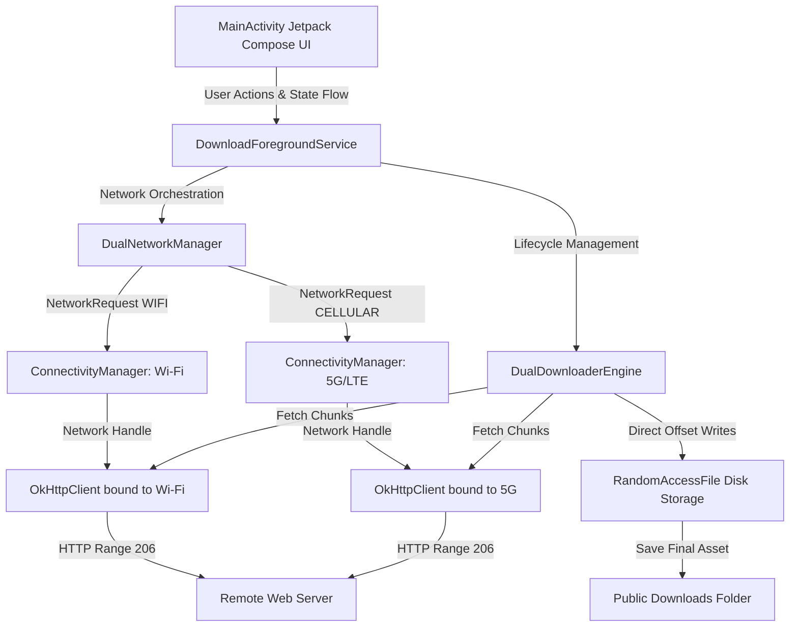
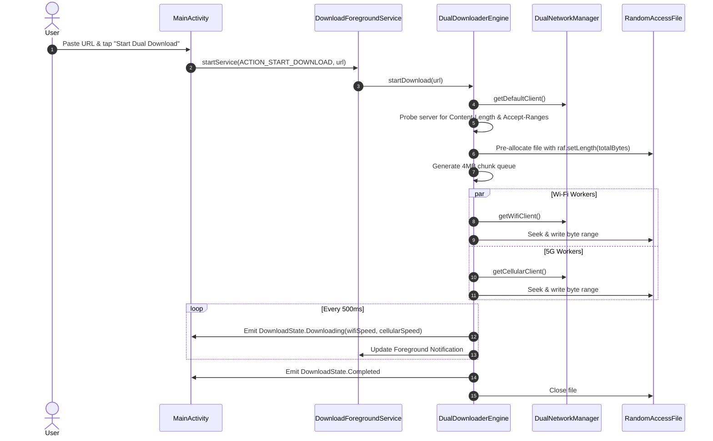

# Architecture

## System Overview
DualBoost Downloader is an Android application that enables simultaneous multi-network data transfer on devices equipped with multiple network interfaces (Wi-Fi and Cellular). Rather than relying on the operating system's default single-interface routing table, the application binds independent network sockets to distinct physical interfaces using Android's `ConnectivityManager` and `Network.socketFactory`.

## System Diagram



## Tech Stack
- **Language**: Kotlin 2.0.21
- **Platform**: Android SDK 35 (Target: Android 15 / Pixel 9, Min: API 26)
- **UI Framework**: Android Jetpack Compose with Material 3
- **Concurrency**: Kotlin Coroutines (`kotlinx.coroutines.android` 1.9.0) with StateFlow
- **Networking**: Square OkHttp 4.12.0
- **Build System**: Gradle 8.10.2 via Kotlin DSL (`build.gradle.kts`)
- **Tooling**: Android Debug Bridge (ADB), Command-Line Tools (no IDE dependency)

## Repository Structure
```
app/src/main/
├── AndroidManifest.xml
└── java/com/dualboost/downloader/
    ├── data/
    │   └── DownloadModel.kt               # StateFlow models and chunk descriptors
    ├── network/
    │   └── DualNetworkManager.kt          # Dual-interface socket binding
    ├── engine/
    │   └── DualDownloaderEngine.kt        # Adaptive work queue & RandomAccessFile writer
    ├── service/
    │   └── DownloadForegroundService.kt   # Android dataSync Foreground Service
    └── ui/
        ├── MainActivity.kt                # Compose screen & Share Sheet receiver
        └── theme/Theme.kt                 # Material 3 color schemes
```

## Application Layers
1. **Presentation Layer (`com.dualboost.downloader.ui`)**:
   - `MainActivity`: Lifecycle observer, Intent handler (`ACTION_SEND`), and Compose layout renderer.
   - `MainViewModel`: Application-scoped ViewModel orchestrating URL inputs, preset selection models (`QuickTestPreset`), and action enablement state machine.
   - Collects `StateFlow` from `DownloadRepository` to display live speed gauges, dual-color interface ratios, and error recovery states.
2. **Repository & Application Layer (`com.dualboost.downloader.data`, `DualBoostApp`)**:
   - `DualBoostApp`: `Application` class holding the singleton `DownloadRepository`.
   - `DownloadRepository`: Coordinates `DualNetworkManager` and `DualDownloaderEngine`, dispatching background tasks to `DownloadForegroundService` without relying on ephemeral service bindings.
3. **Service Layer (`com.dualboost.downloader.service`)**:
   - `DownloadForegroundService`: Keeps process alive when screen locks or app moves to background.
   - Holds Android `PowerManager.PARTIAL_WAKE_LOCK` to prevent CPU throttling while downloading.
   - Manages Android `NotificationManager` with a 1000ms throttler to avoid system message shedding.
   - Guards against race conditions by checking current engine state before initiating downloads.
4. **Execution Engine Layer (`com.dualboost.downloader.engine`)**:
   - `DualDownloaderEngine`: Dynamically computes headers (`Referer`, `Origin`, `Accept-Encoding`), probes remote servers, validates storage via `StatFs`, partitions files into 4MB byte segments, manages work queues, computes binary Megabytes per second (`MB/s`) speed with adaptive `KB/s` formatting (`formatSpeed`), handles single-stream non-range server fallbacks, and writes to disk via `RandomAccessFile`.
   - `SpeedTestEngine`: Ephemeral 3-phase throughput benchmark engine (Wi-Fi 3s -> 5G 3s -> DualBoost 4s) streaming bytes directly into an in-memory discard buffer (0 bytes stored on disk) and reporting real-time speeds in `MB/s`.
5. **Transport Layer (`com.dualboost.downloader.network`)**:
   - `NetworkProvider`: Decoupled interface defining interface availability and client factories, allowing seamless MockWebServer integration testing.
   - `DualNetworkManager`: Listens to `ConnectivityManager` callbacks for `TRANSPORT_WIFI` and `TRANSPORT_CELLULAR`.
   - Produces dedicated `OkHttpClient` instances whose sockets are locked to specific physical interfaces.

## Database Architecture
- **MVP State**: In-memory state management. Chunks and real-time telemetry reside in memory.
- **Planned for Future**: SQLite / Room persistence for download history, paused downloads, and resumed queue state across device reboots.

## API Architecture
The app communicates with third-party HTTP/HTTPS servers implementing standard RFC 7233 Range Requests:
1. **Probe Phase**:
   ```http
   HEAD /large-archive.zip HTTP/1.1
   Host: example.com
   ```
   Or fallback range test:
   ```http
   GET /large-archive.zip HTTP/1.1
   Host: example.com
   Range: bytes=0-0
   ```
2. **Segmented Chunk Phase**:
   ```http
   GET /large-archive.zip HTTP/1.1
   Host: example.com
   Range: bytes=0-4194303
   ```

## External Services
- No proprietary cloud servers, proxy servers, or third-party tracking services are used.
- All connections connect directly point-to-point from device to the target download host.

## Data Flow



## Architectural Patterns
- **Channel Bonding at Application Layer**: Segmenting workloads across disparate interfaces at the HTTP layer instead of kernel/packet bonding.
- **Dynamic Work Queue**: Workers pull chunks on demand. Faster connections naturally claim more chunks, preventing straggler bottlenecks.
- **Zero-Copy Disk Writes**: Direct offset seek and write eliminates the memory and CPU overhead of joining temp files at the end.

## System Boundaries
- **App Boundary**: Bounded by standard Android application permissions (`INTERNET`, `ACCESS_NETWORK_STATE`, `CHANGE_NETWORK_STATE`).
- **OS Boundary**: Relies on Android's `ConnectivityManager.requestNetwork` to override the default single-network routing rule.

## Scalability Considerations
- Chunk size is tuned to 4 MB to optimize HTTP handshake overhead against load distribution efficiency.
- Concurrency is capped at 4 simultaneous coroutines (2 Wi-Fi, 2 5G) to avoid socket thrashing or TCP congestion collapses on mobile networks.

## Security Architecture
- TLS 1.3 / HTTPS supported natively through OkHttp.
- Downloaded assets are placed in standard external storage without granting arbitrary system-wide file manipulation privileges.

## Deployment Architecture
- Built via Gradle CLI (`.\gradlew.bat assembleDebug`).
- Deployed directly to attached Android device via ADB (`adb install -r app-debug.apk`).
- Tested headlessly via `adb shell am start` and monitored via `adb logcat`.

## Architecture Decisions
- *Decision*: Native Kotlin over Flutter/React Native. *Rationale*: Deep integration with Android `ConnectivityManager` and `Network.socketFactory` requires low-level platform APIs.
- *Decision*: Direct `RandomAccessFile` over temp file concatenation. *Rationale*: Zero merge delay and eliminates the requirement for double disk storage.

## Resilience & Lifecycle Management Architecture
- **Thread-Safe Active Call Tracking**: All in-flight `okhttp3.Call` instances are tracked in a thread-safe `ConcurrentHashMap` set with double-checked registration (`registerActiveCall`). When `pauseDownload()` is called, each in-flight call is cancelled immediately via `call.cancel()`, terminating blocking socket I/O loops in under 50ms.
- **Interface Circuit-Breaker**: Tracks consecutive network failures per interface (`wifiFailures`, `cellularFailures`). If an interface fails 2 consecutive chunks (e.g. ISP peering timeout or routing collapse), it enters backoff, dynamically handing off all pending queue chunks to the healthy interface without terminating the overall download.
- **Cellular Probe Failover**: If the initial server capability probe (`HEAD` or `Range: bytes=0-0`) encounters a timeout on the default network (Wi-Fi), the engine automatically falls back to the cellular socket to verify `Content-Length` and `Accept-Ranges`.
- **Worker Starvation Prevention**: Coroutine workers remain active in an adaptive waiting loop until the entire queue reaches terminal status (`COMPLETED`), preventing premature worker shutdown when chunks are temporarily claimed.
- **Compose State Keying**: Jetpack Compose `AnimatedContent` uses `contentKey = { it::class }` to isolate enter/exit transitions strictly to lifecycle transitions (`Idle` -> `Probing` -> `Downloading` -> `Completed`), completely eliminating alpha-flicker during continuous byte-level progress emissions.
- **Persistent Chunk Resumption (.dualboost_meta)**: In-progress segmented downloads persist completed chunk indices to an atomic sidecar file (`<filename>.dualboost_meta`). On restart or resume after pause, the engine reads the metadata, pre-fills byte counters, marks completed chunks, and requests only missing chunks from the server, eliminating bandwidth waste. Metadata files are automatically cleaned up upon 100% completion or explicit discard.
- **Overflow-Safe Pre-Flight Storage Check**: Prior to creating or pre-allocating files, `checkAvailableStorage` calculates required additional disk space with a 20 MB safety buffer and 64-bit Long arithmetic overflow protection, throwing an informative `IOException` if space is insufficient.
- **Server ETag & Last-Modified Verification**: Persists remote cache validators (`etag`, `lastModified`) alongside chunk metadata. On resume, if remote validators have changed, the engine safely discards obsolete partial files and restarts cleanly from byte 0.
- **Public MediaStore Export Pipeline**: Upon 100% completion, finished downloads are seamlessly exported to Android's public `MediaStore.Downloads` (`IS_PENDING = 1` -> `0`), granting immediate visibility in Google Files, Chrome, and third-party media players with an accessible Content URI.
- **Startup Incomplete Download Auto-Recovery**: During application startup, `restoreIncompleteDownload()` scans the download directory for active `.dualboost_meta` files, restoring the last active download directly into `DownloadState.Paused` and pre-populating `MainViewModel`.
- **Discard Lifecycle Decoupling (`ACTION_DISCARD_DOWNLOAD`)**: Discarding a download completely decouples service shutdown from pause logic. `DownloadForegroundService` handles `ACTION_DISCARD_DOWNLOAD` by stopping foreground notifications immediately without invoking `downloaderEngine.pauseDownload()`. Concurrently, `DualDownloaderEngine` engages an atomic `isDiscarding` latch that prevents coroutine cancellation from overriding the transition to `DownloadState.Idle`. Partial files and metadata are deleted, and `MainViewModel` preserves the user's input URL for immediate re-use.
- **Ephemeral Speed Benchmark Engine (`SpeedTestEngine`)**: A non-storage benchmarking pipeline executing a 3-phase automated throughput sequence (Wi-Fi 3s, 5G Cellular 3s, DualBoost Aggregated 4s). Pulls high-speed CDN chunk streams into an in-memory discarding buffer (`ByteArray(32768)`), calculating real-time and aggregate MB/s while completely bypassing disk storage (**zero bytes stored on disk**). Automatically calculates the aggregate boost gain multiplier and exposes `SpeedTestState` via reactive StateFlow.
- **Adaptive Two-Stage Range Probe & Desktop Spoofing (`ADR-019`)**: When remote CDNs or file hosts decline byte ranges for mobile User-Agents (`HTTP 200` instead of `206`), the probe engine executes an automatic Stage 2 fallback using Windows 11 Chrome Desktop headers and Client Hints (`Sec-CH-UA-Mobile: ?0`, `Sec-CH-UA-Platform: "Windows"`). Unlocks segmented multi-channel downloading for mobile-restricted hosts, serializes `isDesktopSpoofed=true` to `.dualboost_meta` for resume continuity, unthrottles `SpeedTestEngine`, and surfaces a subtle `⚡ Desktop Mode Active` badge in the UI.

## Constraints
- Server must support HTTP Range requests (either via standard mobile headers or desktop browser spoofing) for dual-channel acceleration.
- Android system setting "Mobile data always active" must be enabled in Developer Options.


