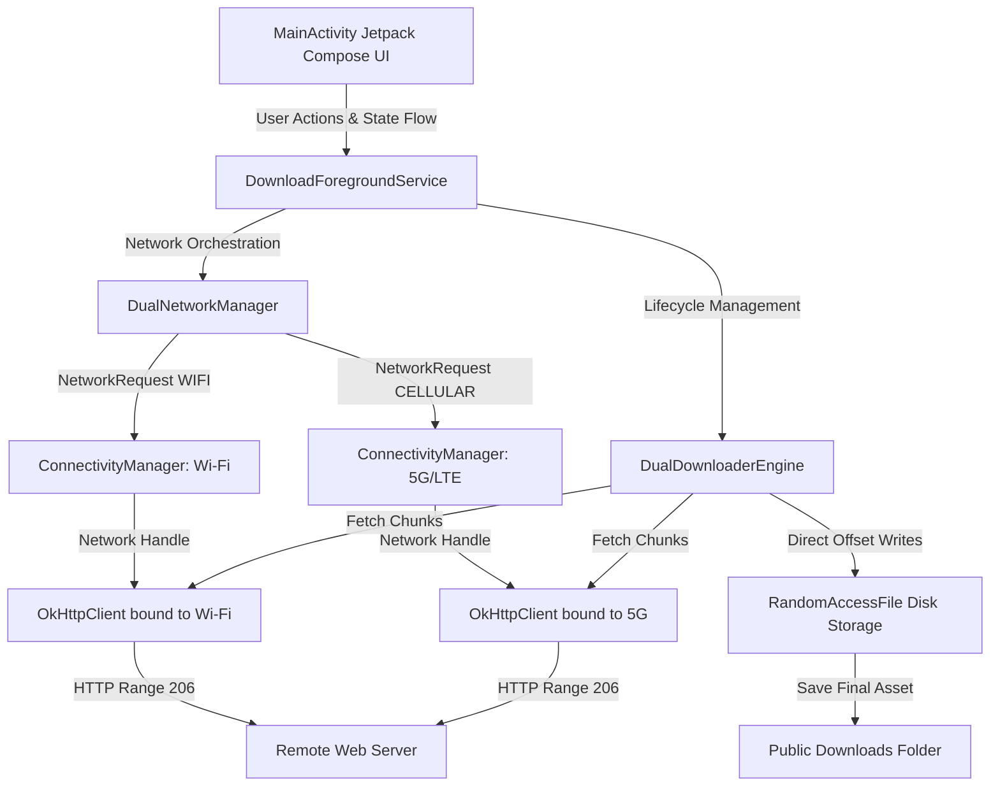
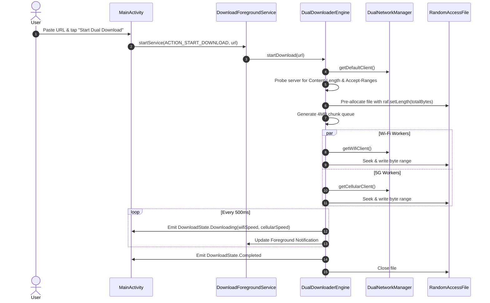

# Architecture

## System Overview
DualBoost Downloader is an Android application that enables simultaneous multi-network data transfer on devices equipped with multiple network interfaces (Wi-Fi and Cellular). Rather than relying on the operating system's default single-interface routing table, the application binds independent network sockets to distinct physical interfaces using Android's `ConnectivityManager` and `Network.socketFactory`.

## System Diagram



## Tech Stack
- **Language**: Kotlin 2.0.21
- **Platform**: Android SDK 35 (Target: Android 15 / Pixel 9, Min: API 26)
- **UI Framework**: Android Jetpack Compose with Material 3
- **Concurrency**: Kotlin Coroutines (`kotlinx.coroutines.android` 1.9.0) with StateFlow
- **Networking**: Square OkHttp 4.12.0 (TLS 1.2+ `MODERN_TLS` & Certificate Pinning)
- **Security & Crypto**: AndroidX Security Crypto (`security-crypto` 1.1.0-alpha06) for Keystore-backed AES-256-GCM
- **Build System**: Gradle 8.10.2 via Kotlin DSL (`build.gradle.kts`)
- **Tooling**: Android Debug Bridge (ADB), Command-Line Tools (no IDE dependency)

## Repository Structure
```
app/src/main/
├── AndroidManifest.xml
└── java/com/dualboost/downloader/
    ├── data/
    │   └── DownloadModel.kt               # StateFlow models and chunk descriptors
    ├── network/
    │   └── DualNetworkManager.kt          # Dual-interface socket binding
    ├── engine/
    │   └── DualDownloaderEngine.kt        # Adaptive work queue & RandomAccessFile writer
    ├── service/
    │   └── DownloadForegroundService.kt   # Android dataSync Foreground Service
    └── ui/
        ├── MainActivity.kt                # Compose screen & Share Sheet receiver
        └── theme/Theme.kt                 # Material 3 color schemes
```

## Application Layers
1. **Presentation Layer (`com.dualboost.downloader.ui`)**:
   - `MainActivity`: Lifecycle observer, clipboard monitor, Intent handler (`ACTION_SEND`), and Compose layout renderer featuring Smart Context Pill Banner, `SegmentedChunkStrip`, and celebratory completion banner.
   - `MainViewModel`: Application-scoped ViewModel orchestrating URL inputs, clipboard auto-detection (`detectedClipboardUrl`), preset selection models (`QuickTestPreset`), and action enablement state machine.
   - Collects `StateFlow` from `DownloadRepository` to display live speed gauges, countdown ETA remaining, dual-color interface ratios, multi-block chunk visualizers (`ChunkSnapshot`), and error recovery states.
2. **Repository & Application Layer (`com.dualboost.downloader.data`, `DualBoostApp`)**:
   - `DualBoostApp`: `Application` class holding the singleton `DownloadRepository`.
   - `DownloadRepository`: Coordinates `DualNetworkManager` and `DualDownloaderEngine`, dispatching background tasks to `DownloadForegroundService` without relying on ephemeral service bindings.
3. **Service Layer (`com.dualboost.downloader.service`)**:
   - `DownloadForegroundService`: Keeps process alive when screen locks or app moves to background.
   - Holds Android `PowerManager.PARTIAL_WAKE_LOCK` with automated 25-minute periodic renewal job to prevent CPU throttling on multi-hour downloads.
   - Manages Android `NotificationManager` with a 1000ms throttler to avoid system message shedding.
   - Guards against race conditions by checking current engine state before initiating downloads.
4. **Execution Engine Layer (`com.dualboost.downloader.engine`)**:
   - `DualDownloaderEngine`: Dynamically computes headers, probes remote servers, validates storage via `StatFs`, partitions files into 10MB byte segments, manages concurrent work queues, produces live `ChunkSnapshot` arrays, calculates ETA countdown seconds (`formatEta`), computes binary Megabytes per second (`MB/s`) speed with adaptive `KB/s` formatting (`formatSpeed`), handles single-stream non-range server fallbacks, and writes to disk via a single shared `RandomAccessFile` handle serialized under `fileWriteMutex`.
   - `SpeedTestEngine`: Ephemeral 3-phase throughput benchmark engine (Wi-Fi 3s -> 5G 3s -> DualBoost 4s) streaming bytes directly into an in-memory discard buffer (0 bytes stored on disk) and reporting real-time speeds in `MB/s`.
5. **Transport Layer (`com.dualboost.downloader.network`)**:
   - `NetworkProvider`: Decoupled interface defining interface availability, signal level telemetry, cellular generation state, and client factories, allowing seamless MockWebServer integration testing.
   - `DualNetworkManager`: Listens to `ConnectivityManager` callbacks for `TRANSPORT_WIFI` and `TRANSPORT_CELLULAR`.
   - Produces dedicated `OkHttpClient` instances whose sockets are locked to specific physical interfaces, enforcing `MODERN_TLS` (TLS 1.2+ with forward secrecy) and `CertificatePinner` for `*.workers.dev` endpoints.
   - **Signal Telemetry & Generation Detection**:
     - Wi-Fi signal level is continuously computed via `NetworkCapabilities.signalStrength` (API 29+) or legacy `WifiManager.calculateSignalLevel(rssi, 5)`.
     - Cellular signal level is computed via `NetworkCapabilities.signalStrength` mapped across 5 discrete buckets (0..4).
     - Cellular generation (`CellularGeneration.FOUR_G` vs `CellularGeneration.FIVE_G`) is dynamically resolved via `TelephonyCallback.DisplayInfoListener` (`TelephonyDisplayInfo.overrideNetworkType` including `OVERRIDE_NETWORK_TYPE_NR_NSA` and `OVERRIDE_NETWORK_TYPE_NR_ADVANCED` on API 31+) with fallback to telephony network type (`NETWORK_TYPE_NR` vs `NETWORK_TYPE_LTE`), gracefully informing the UI to warn users when only 4G LTE is active.

## Database Architecture & Persistence
- **Runtime Engine State**: In-memory state management. Chunks and real-time telemetry reside in memory with atomic `.dualboost_meta` sidecar files in `context.noBackupFilesDir/dualboost_meta` for pause/resume continuity.
- **Download History & File Library**: App-private atomic JSON ledger (`DownloadHistoryRepository`) storing completed download records in `context.noBackupFilesDir/download_history.json`. Uses pure Kotlin JSON serialization with atomic `.tmp` staging, thread-safe Mutex locking, and reactive `StateFlow` exposure with zero SQLite/Room overhead. Enables persistent storage metering, existence tracking, and safe `FileProvider` triggers (`ACTION_VIEW`, `ACTION_SEND`).

## API Architecture
The app communicates with third-party HTTP/HTTPS servers implementing standard RFC 7233 Range Requests:
1. **Probe Phase**:
   ```http
   HEAD /large-archive.zip HTTP/1.1
   Host: example.com
   ```
   Or fallback range test:
   ```http
   GET /large-archive.zip HTTP/1.1
   Host: example.com
   Range: bytes=0-0
   ```
2. **Segmented Chunk Phase**:
   ```http
   GET /large-archive.zip HTTP/1.1
   Host: example.com
   Range: bytes=0-4194303
   ```

## External Services
- No proprietary cloud servers, proxy servers, or third-party tracking services are used.
- All connections connect directly point-to-point from device to the target download host.

## Data Flow



## Architectural Patterns
- **Channel Bonding at Application Layer**: Segmenting workloads across disparate interfaces at the HTTP layer instead of kernel/packet bonding.
- **Dynamic Work Queue**: Workers pull chunks on demand. Faster connections naturally claim more chunks, preventing straggler bottlenecks.
- **Zero-Copy Disk Writes**: Direct offset seek and write eliminates the memory and CPU overhead of joining temp files at the end.

## System Boundaries
- **App Boundary**: Bounded by standard Android application permissions (`INTERNET`, `ACCESS_NETWORK_STATE`, `CHANGE_NETWORK_STATE`).
- **OS Boundary**: Relies on Android's `ConnectivityManager.requestNetwork` to override the default single-network routing rule.

## Scalability Considerations
- Chunk size is tuned to 4 MB to optimize HTTP handshake overhead against load distribution efficiency.
- Concurrency is capped at 4 simultaneous coroutines (2 Wi-Fi, 2 5G) to avoid socket thrashing or TCP congestion collapses on mobile networks.

## Security Architecture
- **Transport Security**: TLS 1.3 / HTTPS strictly enforced via `android:usesCleartextTraffic="false"` in `AndroidManifest.xml`. Cleartext HTTP is blocked across all network requests.
- **Fail-Closed Header-Only Worker Authentication (`SEC-002`, `SEC-011`)**: Cloud Slicer strictly checks the `X-Slicer-Key` HTTP header using constant-time string comparison (`timingSafeEqual`) to prevent timing side-channel attacks and open proxy abuse. Secret keys are never transmitted via URL query parameters (`?key=`), protecting credentials from exposure in browser history, logs, and HTTP Referer headers.
- **Anti-SSRF & DNS Rebinding Protection (`SEC-001`, `SEC-012`)**: Cloud Slicer validates target URLs (`validateTargetUrl`), rejecting non-HTTP/HTTPS protocols, RFC 1918 private subnets, loopback (`127.0.0.1`, `localhost`), link-local/cloud metadata (`169.254.169.254`), CGNAT, wildcard dynamic DNS rebinding services (`*.nip.io`, `*.sslip.io`, etc.), and internal TLDs (`.local`, `.internal`, `.lan`). In addition, pre-fetch DNS verification via Cloudflare DNS-over-HTTPS resolves and validates A records prior to fetching.
- **Edge Stream Bounds (`SEC-005`)**: Maximum slice sizes are clamped to 16 MB (`MAX_SLICE_SIZE = 16 * 1024 * 1024`) to eliminate edge memory exhaustion.
- **Path Traversal Containment (`SEC-003`)**: Android filename extraction from `Content-Disposition` and URL paths strips all directory traversal sequences (`/`, `\`) and sanitizes special characters (`[a-zA-Z0-9._\-\s()]`). `resolveWritableOutputFile` strictly enforces canonical directory containment (`candidate.canonicalPath.startsWith(safeBaseCanonical)`).
- **Sidecar Metadata Isolation (`SEC-009`)**: `.dualboost_meta` session files are stored strictly within the application's private internal storage (`context.noBackupFilesDir/dualboost_meta`), completely shielding download URLs, ETags, and tokens from third-party app inspection.
- **Intent Injection Defense (`SEC-004`)**: Exported `MainActivity` strictly pre-populates shared URLs without unauthenticated background download execution (`auto_start` removed).
- **Backup & Credential Isolation (`SEC-006`)**: `android:allowBackup="false"` prevents extraction of SharedPreferences or user secrets via ADB or physical backups.
- **Logcat Privacy Sanitization (`SEC-007`)**: All logged URLs are stripped of query parameters (`?`) via `sanitizeUrlForLog` to protect pre-signed authorization tokens from exposure.
- **Cryptographic File Integrity (`SEC-013`)**: Streaming SHA-256 integrity calculation upon download completion with interactive 1-click clipboard verification badge in the Compose UI.

## Deployment Architecture
- Built via Gradle CLI (`.\gradlew.bat assembleDebug`).
- Deployed directly to attached Android device via ADB (`adb install -r app-debug.apk`).
- Tested headlessly via `adb shell am start` and monitored via `adb logcat`.

## Architecture Decisions
- *Decision*: Native Kotlin over Flutter/React Native. *Rationale*: Deep integration with Android `ConnectivityManager` and `Network.socketFactory` requires low-level platform APIs.
- *Decision*: Direct `RandomAccessFile` over temp file concatenation. *Rationale*: Zero merge delay and eliminates the requirement for double disk storage.

## Resilience & Lifecycle Management Architecture
- **Thread-Safe Active Call Tracking**: All in-flight `okhttp3.Call` instances are tracked in a thread-safe `ConcurrentHashMap` set with double-checked registration (`registerActiveCall`). When `pauseDownload()` is called, each in-flight call is cancelled immediately via `call.cancel()`, terminating blocking socket I/O loops in under 50ms.
- **Interface Circuit-Breaker**: Tracks consecutive network failures per interface (`wifiFailures`, `cellularFailures`). If an interface fails 2 consecutive chunks (e.g. ISP peering timeout or routing collapse), it enters backoff, dynamically handing off all pending queue chunks to the healthy interface without terminating the overall download.
- **Cellular Probe Failover**: If the initial server capability probe (`HEAD` or `Range: bytes=0-0`) encounters a timeout on the default network (Wi-Fi), the engine automatically falls back to the cellular socket to verify `Content-Length` and `Accept-Ranges`.
- **Worker Starvation Prevention**: Coroutine workers remain active in an adaptive waiting loop until the entire queue reaches terminal status (`COMPLETED`), preventing premature worker shutdown when chunks are temporarily claimed.
- **Compose State Keying**: Jetpack Compose `AnimatedContent` uses `contentKey = { it::class }` to isolate enter/exit transitions strictly to lifecycle transitions (`Idle` -> `Probing` -> `Downloading` -> `Completed`), completely eliminating alpha-flicker during continuous byte-level progress emissions.
- **Persistent Chunk Resumption (.dualboost_meta)**: In-progress segmented downloads persist completed chunk indices to an atomic sidecar file (`<filename>.dualboost_meta`). On restart or resume after pause, the engine reads the metadata, pre-fills byte counters, marks completed chunks, and requests only missing chunks from the server, eliminating bandwidth waste. Metadata files are automatically cleaned up upon 100% completion or explicit discard.
- **Overflow-Safe Pre-Flight Storage Check**: Prior to creating or pre-allocating files, `checkAvailableStorage` calculates required additional disk space with a 20 MB safety buffer and 64-bit Long arithmetic overflow protection, throwing an informative `IOException` if space is insufficient.
- **Server ETag & Last-Modified Verification**: Persists remote cache validators (`etag`, `lastModified`) alongside chunk metadata. On resume, if remote validators have changed, the engine safely discards obsolete partial files and restarts cleanly from byte 0.
- **Public MediaStore Export Pipeline**: Upon 100% completion, finished downloads are seamlessly exported to Android's public `MediaStore.Downloads` (`IS_PENDING = 1` -> `0`), granting immediate visibility in Google Files, Chrome, and third-party media players with an accessible Content URI.
- **Startup Incomplete Download Auto-Recovery**: During application startup, `restoreIncompleteDownload()` scans the download directory for active `.dualboost_meta` files, restoring the last active download directly into `DownloadState.Paused` and pre-populating `MainViewModel`.
- **Discard Lifecycle Decoupling (`ACTION_DISCARD_DOWNLOAD`)**: Discarding a download completely decouples service shutdown from pause logic. `DownloadForegroundService` handles `ACTION_DISCARD_DOWNLOAD` by stopping foreground notifications immediately without invoking `downloaderEngine.pauseDownload()`. Concurrently, `DualDownloaderEngine` engages an atomic `isDiscarding` latch that prevents coroutine cancellation from overriding the transition to `DownloadState.Idle`. Partial files and metadata are deleted, and `MainViewModel` preserves the user's input URL for immediate re-use.
- **Ephemeral Speed Benchmark Engine (`SpeedTestEngine`)**: A non-storage benchmarking pipeline executing a 3-phase automated throughput sequence (Wi-Fi 3s, 5G Cellular 3s, DualBoost Aggregated 4s). Pulls high-speed CDN chunk streams into an in-memory discarding buffer (`ByteArray(32768)`), calculating real-time and aggregate MB/s while completely bypassing disk storage (**zero bytes stored on disk**). Automatically calculates the aggregate boost gain multiplier and exposes `SpeedTestState` via reactive StateFlow.
- **Adaptive Three-Stage Range Probe & Desktop Spoofing (`ADR-019`, `ADR-020`)**: When remote CDNs or file hosts decline byte ranges for mobile User-Agents (`HTTP 200` instead of `206`), the probe engine executes an automatic Stage 2 fallback using Windows 11 Chrome Desktop headers and Client Hints (`Sec-CH-UA-Mobile: ?0`, `Sec-CH-UA-Platform: "Windows"`). If the server continues to reject ranges, the engine executes Stage 3 fallback via the user's Personal Cloud Slicer (`ADR-020`).
- **Personal Cloud Slicer Architecture (`ADR-020`)**: A zero-cost serverless stream-slicing proxy deployed to Cloudflare Workers (`cloud-slicer/worker.js`). For dynamic streaming URLs (e.g. Cloudflare speed test streams) that omit `Accept-Ranges`, the worker fetches the stream, skips to `rangeStart`, and enqueues exact byte slices into a standard `HTTP 206 Partial Content` stream. Slicer configuration is persisted via `SlicerPreferences`, supports optional `SECRET_KEY` tokens, includes an in-app `SettingsBottomSheet` with 1-click script copying and live health verification, and renders an eye-catching `⚡ Cloud Slicer Active` badge.
- **Scoped Storage Conflict-Free File Resolution & Directory Fallback (`ADR-021`)**: To resolve Android Scoped Storage isolation when files already exist in public Downloads owned by other applications, `resolveWritableOutputFile` checks if existing files can be opened in `rw` mode or belong to the active download. If locked or owned by another app UID, it automatically generates a non-conflicting unique name (`name (1).ext`). If public storage is unwritable, it seamlessly falls back to app-specific external storage (`getExternalFilesDir(Environment.DIRECTORY_DOWNLOADS)`). Completed files in public storage are indexed via `MediaScannerConnection.scanFile` with zero disk duplication. Dual-location resume is supported via `restoreIncompleteDownload`.

## Constraints
- Server must support HTTP Range requests (either via standard mobile headers, desktop browser spoofing, or Personal Cloud Slicer) for dual-channel acceleration.
- Android system setting "Mobile data always active" must be enabled in Developer Options.


